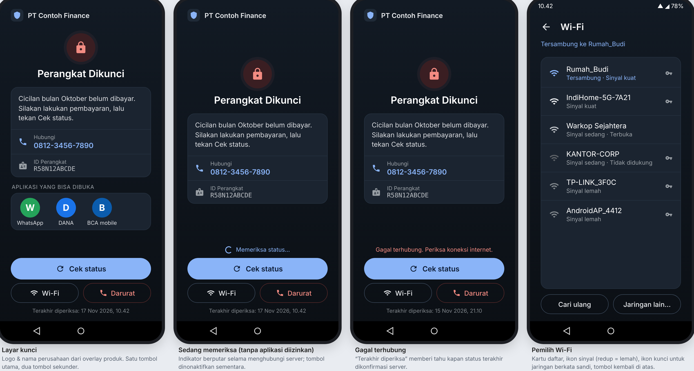

# KioskOS: Device Lock untuk Android (mirip Knox Guard)

Kerangka (scaffold) untuk membangun ROM Android berbasis AOSP yang punya fitur
**lock device / kiosk** yang **tetap aktif walau HP di-factory reset**, seperti
Samsung Knox Guard / Knox Mobile Enrollment.

> Status: kerangka awal. Kode belum dikompilasi terhadap source tree AOSP tertentu.
> Beberapa hidden API berbeda antar versi Android dan perlu disesuaikan (lihat
> [Catatan versi](#catatan-versi-android)).

---

## Cara Samsung Knox bisa bertahan setelah reset

Knox tidak bergantung pada satu trik saja. Ada beberapa lapisan:

| Lapisan | Samsung Knox | KioskOS (repo ini) |
|---|---|---|
| Aplikasi agen ada di OS | Knox agent ada di partisi `system` (read-only) | `KioskLock` jadi **priv-app** di `system_ext`, ikut terpasang lagi setelah reset |
| Pendaftaran otomatis setelah reset | Setup Wizard cek server Samsung pakai IMEI/serial (KME / Knox Guard) | `SetupActivity` jalan **sebelum** Setup Wizard, otomatis jadi **Device Owner**, lalu cek server pakai serial/IMEI |
| Status lokal yang tidak terhapus | Disimpan di area aman (RPMB/TrustZone) | Disimpan di **partisi FRP** (`PersistentDataBlock`), yang memang tidak dihapus factory reset |
| Tidak bisa ganti ROM | Bootloader terkunci + Secure Boot + Knox e-fuse | Bootloader terkunci dengan **kunci AVB Anda sendiri**, OEM unlock dimatikan |
| Tidak bisa diakali dari dalam | Kebijakan MDM tingkat OS | Device Owner: blok factory reset, safe mode, ADB/Developer Options, tambah user, dll. |

Intinya: **factory reset hanya menghapus `/data`**. Semua yang ada di `system`,
partisi FRP, dan server Anda tetap ada. Selama bootloader terkunci dan hanya
menerima ROM yang Anda tandatangani, pengguna tidak bisa menghapus agen ini.

## Alur kerja

```
 Boot pertama / setelah factory reset
        │
        ▼
 SetupActivity (HOME, prioritas > Setup Wizard)
        │ 1. setDeviceOwner(KioskLock)       ← hanya bisa sebelum setup selesai
        │ 2. baca partisi FRP → status terakhir
        │ 3. jika "locked" → kunci SEKARANG (tanpa perlu internet)
        │ 4. jadwalkan sinkron server, nonaktifkan diri
        ▼
 Setup Wizard berjalan normal (atau tertahan di layar kunci jika locked)

 Setiap boot          : BootReceiver → terapkan status dari partisi FRP → sinkron
 Setiap 15 menit      : SyncJobService → GET status dari server (ditandatangani)
 Status server berubah: simpan ke partisi FRP → terapkan kebijakan
```

Saat **terkunci**:
- `LockActivity` dijadikan HOME permanen dan berjalan di **Lock Task Mode**
  (tombol Home/Recents mati, status bar dimatikan).
- Tetap tersedia: **panggilan darurat**, **sambung Wi-Fi**, tombol **cek status**.

Saat **terdaftar** (terkunci maupun tidak):
- Factory reset dari Settings diblokir (bisa diatur), Safe Mode, Developer
  Options/ADB, tambah user, USB file transfer diblokir, OEM unlocking dimatikan.

Saat server mengirim `enrolled=false` (mis. cicilan lunas): semua restriksi dicabut.

## Tampilan di HP



*Mockup yang dibuat dari file layout (`res/layout/`), bukan screenshot perangkat. Font
mengikuti ROM. KioskUpdater tidak punya tampilan; ia bekerja di latar belakang.*

1. **Layar kunci:** logo & nama perusahaan, ikon gembok, kartu berisi pesan, kontak, dan
   ID perangkat, **aplikasi yang diizinkan admin** (mis. WhatsApp, aplikasi bank/e-wallet),
   tombol utama **Cek status**, tombol **Wi-Fi** dan **Darurat**, serta keterangan kapan
   status terakhir dikonfirmasi server. Tombol Home selalu kembali ke layar ini.
2. **Sedang memeriksa:** indikator berputar, tombol dinonaktifkan sementara.
3. **Gagal terhubung:** pesan merah jika tidak ada internet.
4. **Pemilih Wi-Fi** milik KioskLock sendiri (bukan Settings).

Dalam kondisi normal (pesan 2–3 baris + 3 aplikasi) semua isi muat tanpa scroll di layar
360×760 dp. Jika isinya lebih panjang, layar bisa di-scroll sehingga tombol Darurat tetap
terjangkau.

### Identitas perusahaan

```bash
BRAND_NAME="PT Contoh Finance" BRAND_LOGO=~/logo-192.png ./scripts/02-install-kioskos.sh
```

- `BRAND_NAME` mengisi nama di bagian atas layar kunci.
- `BRAND_LOGO` adalah PNG persegi, misalnya 192×192 px, yang tampil di kotak 18dp.
- Warna (`kiosk_accent`, `kiosk_bg_top`, dan lain-lain) ada di
  `vendor/kioskos/apps/KioskLock/res/values/colors.xml` dan bisa di-override lewat overlay
  dengan nama yang sama.

> Logo PNG menimpa `brand_logo.xml` (vektor) lewat overlay statis. Pastikan logo tampil
> setelah build pertama. Jika build menolak dua resource `brand_logo` dengan tipe file
> berbeda, hapus `res/drawable/brand_logo.xml` di repo dan taruh PNG default di sana.

## Struktur repo

```
vendor/kioskos/
├── kioskos.mk                       # di-inherit oleh produk device Anda
├── overlay/…/config.xml             # config_persistentDataPackageName = id.kioskos.lock
├── permissions/privapp-permissions-*.xml
├── libs/common/                     # kioskos-common: HTTP + verifikasi tanda tangan server
├── apps/KioskUpdater/               # update OTA A/B lewat update_engine
└── apps/KioskLock/                  # aplikasi sistem (Device Owner)
    ├── Android.bp
    ├── AndroidManifest.xml
    ├── res/values/config.xml        # URL server, public key, opsi
    └── src/id/kioskos/lock/
        ├── SetupActivity.java       # provisioning otomatis di first boot
        ├── Provisioner.java         # setDeviceOwner (hidden API)
        ├── PersistentLockStore.java # baca/tulis partisi FRP
        ├── LockController.java      # terapkan kebijakan Device Owner
        ├── LockActivity.java        # layar kiosk
        ├── WifiActivity.java        # pemilih Wi-Fi sendiri (Settings tidak diizinkan saat terkunci)
        ├── ServerClient.java        # ambil status + verifikasi tanda tangan
        ├── SyncJobService.java      # sinkron berkala
        └── BootReceiver.java
        (src/ = kode bersama, src-aosp/ = khusus ROM, src-dpc/ = khusus edisi Device Owner)
android-dpc/                         # proyek Gradle edisi Device Owner (lihat docs/DPC.md)
scripts/                             # build, kunci, uji, rilis & publikasi OTA
server/
├── server.py                        # status kunci, OTA, API admin (stdlib + cryptography)
├── static/                          # dashboard admin (/admin/)
├── manage.py                        # kelola admin & token
├── gen_keys.py                      # buat kunci ECDSA penandatangan
└── test_server.py                   # tes server
```

## Langkah membangun

> **Mulai dari emulator dulu:** ikuti [docs/BUILD.md](docs/BUILD.md). Skrip di
> `scripts/` mengotomatiskan setup PC, download AOSP, pemasangan KioskOS, dan build.
> Kunci tanda tangan sendiri (release keys + AVB): [docs/SIGNING.md](docs/SIGNING.md).
> Uji otomatis kunci → reset → terkunci lagi: [docs/TESTING.md](docs/TESTING.md).
> Server & dashboard admin: [docs/SERVER.md](docs/SERVER.md).
> Rilis produksi & update OTA: [docs/RELEASE.md](docs/RELEASE.md).
> **Tanpa ROM custom** (aplikasi Device Owner di Android biasa, bisa dicoba di emulator
> SDK / mini PC): [docs/DPC.md](docs/DPC.md).

### 1. Siapkan AOSP / LineageOS untuk device Anda
Anda butuh source tree yang bisa di-build untuk device target (device tree,
vendor blobs, kernel). LineageOS biasanya paling mudah jika device-nya didukung.

```bash
repo init -u https://android.googlesource.com/platform/manifest -b <branch>
repo sync
# salin folder vendor/kioskos dari repo ini ke root source tree
```

### 2. Inherit produk
Di makefile produk device (mis. `device/<vendor>/<device>/<device>.mk`):

```make
$(call inherit-product, vendor/kioskos/kioskos.mk)
```

Pastikan device punya partisi FRP dan `ro.frp.pst` menunjuk ke sana
(cek `fstab` dan `getprop ro.frp.pst` di HP).

### 3. Kunci server
```bash
cd server
pip install -r requirements.txt
python3 gen_keys.py
```
Tempel public key yang dicetak ke `config_server_public_key` dan isi
`config_server_url` di `apps/KioskLock/res/values/config.xml` (atau lewat overlay produk).

### 4. Gunakan kunci rilis Anda sendiri (WAJIB untuk produksi)
- Buat **platform/release keys** sendiri (jangan pakai test-keys AOSP), karena
  KioskLock ditandatangani dengan platform key.
- Buat **kunci AVB** sendiri (`BOARD_AVB_KEY_PATH`) lalu lakukan
  `fastboot flash avb_custom_key` dan **lock bootloader** (`fastboot flashing lock`).
  Hanya device yang mendukung *custom AVB key* (mis. Pixel) yang bisa dikunci
  dengan ROM custom. Tanpa ini, siapa pun bisa flash ROM stok dan lock-nya hilang.

### 5. Build & flash
```bash
source build/envsetup.sh
lunch <produk>-<release>-user
m
```

### 6. Jalankan server & kelola perangkat

Kelola perangkat dan rilis OTA lewat **dashboard** di `https://<server>/admin/`
(lihat [docs/SERVER.md](docs/SERVER.md)):

```bash
cd server && python3 manage.py add-admin budi       # token admin per orang
ADMIN_TOKENS_FILE=data/admins.txt python3 server.py # taruh di belakang HTTPS
```

Atau lewat API langsung:

```bash
# daftarkan + kunci
curl -X PUT -H 'Authorization: Bearer rahasia' \
  -d '{"locked":true,"message":"Cicilan bulan ini belum dibayar","contact":"0812-xxxx"}' \
  https://lock.example.com/admin/api/devices/<SERIAL>

# buka kunci (tetap terdaftar)
curl -X PUT -H 'Authorization: Bearer rahasia' -d '{"locked":false}' \
  https://lock.example.com/admin/api/devices/<SERIAL>

# lepas perangkat (lunas)
curl -X DELETE -H 'Authorization: Bearer rahasia' \
  https://lock.example.com/admin/api/devices/<SERIAL>
```

## Keamanan

- **Respons server ditandatangani** (ECDSA P-256) dan memuat `nonce` + `serial`.
  Tanpa ini, orang bisa memalsukan server/DNS untuk membuka kunci.
- Status yang lebih lama dari yang tersimpan diabaikan (`issued_at`, anti-replay).
- Simpan `private_key.pem` di HSM/KMS untuk produksi.
- Saat terkunci, hanya KioskLock dan dialer darurat (`com.android.phone`) yang
  boleh berjalan. **Settings tidak diizinkan**; Wi-Fi dipilih lewat layar
  pemilih Wi-Fi milik KioskLock sendiri (`WifiActivity`), sehingga tidak ada
  jalan masuk ke Settings dari layar kunci.

### Batasan yang perlu dipahami
- Jika **bootloader bisa di-unlock**, semua perlindungan bisa dilewati. Ini
  lapisan terpenting.
- Akses tingkat rendah (EDL Qualcomm, BROM MediaTek) bisa menulis ulang partisi
  apa pun, termasuk FRP. Knox melawannya dengan e-fuse & TrustZone; untuk ROM
  custom, perlindungan ini tergantung chipset dan kerja sama vendor SoC.
- Overlay `config_persistentDataPackageName` **menggantikan FRP Google**. Jika
  ROM Anda memakai GMS, pilih salah satu atau simpan status di partisi lain
  (mis. `/mnt/vendor/persist`) lewat service native + SELinux policy.

## Catatan versi Android
- `DevicePolicyManager.setDeviceOwner(...)` dan `setActiveAdmin(...)` adalah
  hidden API; signature-nya berubah antar versi. Sesuaikan di `Provisioner.java`.
- Android 15 menambah *FRP hardening* pada `PersistentDataBlockService`;
  uji perilaku `write()` setelah reset di versi target Anda.
- Sejak Android 14, AOSP punya **Device Lock Controller** resmi
  (`packages/modules/DeviceLock`) untuk HP kredit, tapi itu terhubung ke backend
  Google. Repo ini adalah alternatif mandiri tanpa GMS.

## Alternatif tanpa membuat ROM sendiri
Jika tidak perlu bertahan dari reset tanpa Google, cukup pakai
**Android Enterprise zero-touch** atau **Android Management API**: HP otomatis
terdaftar lagi ke MDM Anda setelah reset, dengan HP yang dibeli dari reseller resmi.

## Aspek hukum
Penguncian HP kredit wajib transparan: cantumkan di perjanjian, beri tahu
konsumen sebelum mengunci, dan **jangan blokir panggilan darurat**. Ikuti
aturan OJK / perlindungan konsumen yang berlaku untuk pembiayaan.
